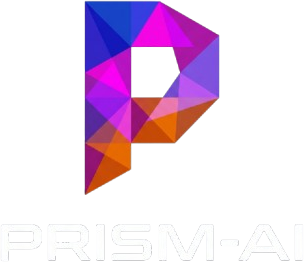

<div align="center">



# PRISM-AI — Primary School Intelligent Student Management & Predictive Analytics Ecosystem

**Next-Generation Edge AI Facial Recognition Attendance, Emotion Analysis & School Administration Platform**

[](https://react.dev/)
[](https://vite.dev/)
[](https://expressjs.com/)
[](https://supabase.com/)
[](https://github.com/deepinsight/insightface)
[](https://ultralytics.com)
[](https://onnxruntime.ai/docs/execution-providers/DirectML-ExecutionProvider.html)

</div>

---

## 📖 Table of Contents
- [About PRISM-AI](#-about-prism-ai)
- [System Architecture](#-system-architecture)
- [Core Features](#-core-features)
- [Technology Stack](#-technology-stack)
- [Repository Structure](#-repository-structure)
- [Hardware & Software Prerequisites](#-hardware--software-prerequisites)
- [Getting Started & Installation](#-getting-started--installation)
- [Role-Based Access Control (RBAC)](#-role-based-access-control-rbac)
- [Database Migrations & Demo Data](#-database-migrations--demo-data)
- [Demo Credentials](#-demo-credentials)
- [Troubleshooting & FAQ](#-troubleshooting--faq)

---

## 🌟 About PRISM-AI

**PRISM-AI** is an automated school attendance and engagement monitoring platform tailored for Malaysian primary schools (following the standard **KSSR** curriculum). 

Traditional school roll calls suffer from manual data entry errors, bottleneck queues at entrance gates, and a lack of real-time visibility for parents and administrators. PRISM-AI replaces outdated paper registers and barcode cards with **real-time edge AI facial recognition** and **affective engagement tracking**, seamlessly integrated into a hosted PostgreSQL database with role-based parental and administrative portals.

### 🎯 Key Objectives
1. **Frictionless Morning Check-Ins**: Instantly recognize students as they walk past the entrance camera at up to 30 FPS, marking attendance automatically without stopping.
2. **Student Well-being & Engagement Tracking**: Detect student affective states and calculate classroom engagement rates to flag students at academic or emotional risk early.
3. **Strict Teacher Scoping & Data Privacy**: Enforce strict PostgreSQL Row Level Security (RLS) ensuring teachers manage only their designated classes.
4. **Parent Transparency & Peace of Mind**: Provide parents with a dedicated mobile-friendly portal displaying exact arrival times, attendance percentages, and direct teacher contact.

---

## 🏛 System Architecture

The project consists of 4 distinct operational tiers working in concert:

```
┌─────────────────────────────────────────────────────────────────────────────┐
│                           BROWSER CLIENT (React 19)                         │
│                    Running on Vite Dev Server (Port 5173)                   │
└──────────────────┬───────────────────────────────────────┬──────────────────┘
                   │ /api/* proxied                        │ /stream proxied
                   ▼                                       ▼
┌──────────────────────────────────────┐  ┌───────────────────────────────────┐
│       EXPRESS BRIDGE SERVER          │  │       PYTHON EDGE AI SERVICE      │
│      Node.js Express (Port 3001)     │  │   InsightFace + YOLO (Port 5174)  │
│                                      │  │                                   │
│ • Secure Supabase Service Key        │  │ • DirectML DirectX 12 GPU Accel.  │
│ • Spawns & monitors Python AI        │  │ • 640x640 SCRFD Face Detection    │
│ • Dedupes & batches arrival records  │  │ • 512D ArcFace Cosine Recognition │
│ • Audit logging & fanout notices     │  │ • Face-Crop Emotion Analysis      │
│ • Admin user invite & management     │  │ • Real-time MJPEG live stream     │
└──────────────────┬───────────────────┘  └─────────────────▲─────────────────┘
                   │                                        │
                   │ Supabase JS API                        │ POST /api/attendance
                   ▼                                        │ (every 10s)
┌──────────────────────────────────────┐                    │
│          HOSTED SUPABASE             ├────────────────────┘
│      PostgreSQL 15+ & Auth & RLS     │
│                                      │
│ • 10 Idempotent Migrations           │
│ • User Role Security Policies        │
│ • Automated profile creation trigger │
│ • Biometric PDPA consent ledger      │
└──────────────────────────────────────┘
```

---

## ✨ Core Features

### 1. 📷 Take Attendance (AI Camera Service)
- **Live Facial Recognition**: Utilizes InsightFace `buffalo_l` (SCRFD detector + ArcFace 512-dimensional embeddings).
- **GPU Accelerated**: Runs on Windows using `onnxruntime-directml` (compatible with NVIDIA, AMD, and Intel integrated DirectX 12 GPUs) at full 30 FPS.
- **Child-Process Supervision**: Teachers start and stop the AI directly from the web interface without touching the terminal. The Express bridge auto-monitors process health.

### 2. 🧠 Affective Emotion & Engagement Engine
- **YOLOv8 Emotion Engine (`best_v2.pt`)**: Extracts face crops and classifies emotional states (focused, neutral, fatigued, stressed).
- **Engagement Scoring**: Aggregates attentiveness percentages across classes to identify disengagement trends.
- **Dedicated Engagement Dashboard**: Explore school-wide or class-specific engagement metrics, risk badges, and historical trends.

### 3. 📋 Manual Attendance Fallback
- **Safety Roll-Call**: Full manual fallback view (`/dashboard/attendance`) organized by Year and Class Section.
- **Per-Student Edit Modal**: Adjust individual statuses (`present`, `late`, `absent`, `excused`) and record checkout departure times (`time_out`).
- **Bulk Mark Present**: One-click class-wide attendance marking with automated audit log entries and parent notification fanouts.

### 4. 🏫 Academic Management & Access Control
- **Year & Section Hierarchy**: 6 standard Malaysian academic years (Year 1 to Year 6) with 5 classes each (`Bestari`, `Bijak`, `Cerdas`, `Cerdik`, `Pandai`) — 30 active sections.
- **Strict Teacher Scoping**: Teachers only have access to view and take attendance for classes assigned to them. Foreign classes trigger an **Access Restricted** gate.
- **Cross-Class Comparisons**: School-wide attendance rate comparisons across academic years and sections (restricted to Administrators).

### 5. 👨‍👩‍👧 Parent Portal
- **Child-Centric Dashboard**: Parents sign in to view their child’s live attendance status, arrival timestamps, and historical streaks.
- **Teacher Contact Card**: Direct access to homeroom teacher email and verified identity.
- **PDPA & Biometric Consent**: Legal agreement and biometric consent ledger allowing parents to review and accept data protection policies.

### 6. 📊 Reports & Data Exporting
- **Print-Optimized Summaries**: Clean, formatted print stylesheets for school records.
- **CSV & PDF Exports**: One-click download of attendance registers generated client-side using `jspdf` and `jspdf-autotable`.

---

## 🛠 Technology Stack

| Layer | Technologies |
|---|---|
| **Frontend** | React 19, Vite 8, React Router v7, Lucide Icons, Recharts, jsPDF, PapaParse |
| **Styling** | Handcrafted Almanac Design System, Vanilla CSS, Custom CSS Variables, Glassmorphism |
| **Backend Bridge** | Express 5, Node.js 20+, `@supabase/supabase-js`, CORS, Dotenv |
| **Edge AI** | Python 3.11, InsightFace (SCRFD + ArcFace), OpenCV, ONNX Runtime (DirectML), YOLOv8 PyTorch |
| **Database & Auth** | Supabase (PostgreSQL 15+, Row Level Security, Auth, Triggers, RLS Policies) |

---

## 📁 Repository Structure

```
PRISM-AI/
├── PRISM-ai--web/             # React 19 Frontend application
│   ├── public/                # Static assets, favicon, brand logos
│   │   ├── logo.png           # PRISM-AI geometric emblem
│   │   └── logo-full.png      # Full logo with typography
│   ├── src/
│   │   ├── components/        # Reusable UI components (Modals, Toast, Skeleton, etc.)
│   │   ├── contexts/          # Auth and global application state
│   │   ├── hooks/             # Custom Supabase data hooks (useStudents, useAttendance, etc.)
│   │   ├── layouts/           # DashboardLayout (Sidebar, Topbar, ScopeContext)
│   │   ├── pages/             # Route views (Dashboard, Camera, Attendance, Students, etc.)
│   │   └── lib/               # Utility functions and rate calculators
│   ├── package.json
│   └── vite.config.js         # API and MJPEG stream reverse-proxy config
├── server/                    # Node.js Express 5 API bridge
│   ├── server.js              # Server entry point (port 3001) & AI child process supervisor
│   ├── package.json
│   └── .env.example
├── ai-service/edge/           # Python edge facial recognition & emotion service
│   ├── face_recognition.py    # Main camera capture, SCRFD detection, ArcFace embeddings
│   ├── enroll_student.py      # Interactive face enrollment CLI utility
│   ├── export_models.py       # Model export and optimization
│   ├── requirements.txt       # Python dependencies (onnxruntime-directml, insightface)
│   └── best_v2.pt             # YOLOv8 emotion classification weights
├── supabase/                  # Database definitions
│   ├── migrations/            # 10 sequential, idempotent SQL migrations
│   └── seed.sql               # Reference seed data (Years, Subjects, Class Sections)
├── scripts/                   # One-shot database seeder and randomization utilities
│   ├── migrate-mock-data.mjs  # Generates real auth users and seeds mock school history
│   ├── randomize-classes.cjs  # Randomizes teacher assignments across all 30 classes
│   └── assign-15-teachers.cjs # Balances 15 active teachers across class sections
├── SETUP.md                   # Comprehensive fresh-machine setup manual
└── SESSION_SUMMARY.md         # Detailed session archives & architectural log
```

---

## 💻 Hardware & Software Prerequisites

| Tool | Recommended Version | Purpose |
|---|---|---|
| **Node.js** | **v20 LTS** or **v24** | Vite frontend dev server, Express bridge, database seeders |
| **Python** | **3.11** | InsightFace, OpenCV, PyTorch edge vision pipeline |
| **Webcam** | Any USB / Integrated | Face recognition and live stream feed |
| **GPU** | DirectX 12 capable (Windows) or CUDA (Linux) | **Required for AI inference** (runs via DirectML; no CPU fallback) |
| **Supabase** | Free tier or hosted | PostgreSQL database, Auth, and Storage |

---

## 🚀 Getting Started & Installation

### 1. Clone the Repository
```bash
git clone https://github.com/UMAR-ZHARIEF/PRISM-AI-FYP2.git
cd PRISM-AI-FYP2
```

### 2. Configure Environment Files
Copy the provided examples:

```powershell
# Windows PowerShell
Copy-Item PRISM-ai--web\.env.local.example PRISM-ai--web\.env.local
Copy-Item server\.env.example server\.env
```

Fill in your project credentials from your **Supabase Dashboard → Project Settings → API**:
- **`PRISM-ai--web/.env.local`** (Public anon key for browser RLS queries):
  ```ini
  VITE_SUPABASE_URL=https://your-project-ref.supabase.co
  VITE_SUPABASE_ANON_KEY=your-publishable-anon-key
  ```
- **`server/.env`** (Secret service-role key for administrative bridge operations):
  ```ini
  SUPABASE_URL=https://your-project-ref.supabase.co
  SUPABASE_SECRET_KEY=sb_secret_your-secret-service-key
  ```

### 3. Install Dependencies

```powershell
# Frontend
cd PRISM-ai--web
npm install
cd ..

# Express Bridge
cd server
npm install
cd ..

# Python Edge AI Virtual Environment
cd ai-service\edge
py -3.11 -m venv venv
.\venv\Scripts\Activate.ps1
python -m pip install --upgrade pip
pip install -r requirements.txt
cd ..\..
```

### 4. Apply Database Migrations
In your Supabase dashboard, open the **SQL Editor** and run the migrations in sequential order from `supabase/migrations/`:
1. `0001_initial_schema.sql`
2. `0002_notifications_scope.sql`
3. `0003_consent_and_policies.sql`
4. `0003_notifications_staff_insert.sql`
5. `0004_parent_read_homeroom_teacher.sql`
6. `0005_app_settings_and_checkout.sql`
7. `0005_teacher_class_access_control.sql`
8. `0006_remove_assistant_teacher_scoping.sql`
9. `0007_med_low_fixes.sql`
10. `0008_engagement.sql`
11. Run `supabase/seed.sql` to populate years, subjects, and the 30 class sections.

*(Optional)* Run the demo mock seeder to populate realistic student histories:
```powershell
cd scripts
node migrate-mock-data.mjs
cd ..
```

---

## 🏃 Running the Application

Open two terminal windows:

### Terminal 1: Start Express Bridge
```powershell
cd server
npm start
# Runs on http://localhost:3001
```

### Terminal 2: Start React Frontend
```powershell
cd PRISM-ai--web
npm run dev
# Serves on http://localhost:5173
```

### Launching the AI Camera
1. Navigate to **http://localhost:5173** and sign in as an **Admin** or **Teacher**.
2. Go to **Take Attendance** (`/dashboard/camera`) in the navigation bar.
3. Click **Start AI**. The Express bridge automatically spawns the Python service using DirectML GPU acceleration and streams the annotated MJPEG feed directly to your browser.
4. Click **Stop AI** when roll call concludes.

---

## 👥 Role-Based Access Control (RBAC)

PRISM-AI uses strict role-based authorization enforced both in the UI and via PostgreSQL Row Level Security:

| Feature / Page | Administrator | Teacher | Parent |
|---|:---:|:---:|:---:|
| **Dashboard** | Full School View | Assigned Class Only | ❌ (Redirected) |
| **Take Attendance (AI Camera)** | ✅ Full Access | ✅ Full Access | ❌ |
| **Manual Attendance** | ✅ All Classes | ✅ Assigned Class Only | ❌ |
| **Students Roster** | ✅ Full School | ✅ Assigned Class Only | ❌ |
| **Class Comparison** | ✅ Full Access | ❌ Restricted | ❌ |
| **Attendance Reports** | ✅ All Classes | ✅ Assigned Class Only | ❌ |
| **Face Registration** | ✅ Add / Delete | ❌ View Only | ❌ |
| **Parent Portal** | ❌ | ❌ | ✅ Linked Child Only |

---

## 🔑 Demo Credentials

All seeded mock accounts share the temporary password: `Welcome123!`

| Role | Name | Email | Permissions |
|---|---|---|---|
| **Administrator** | Admin Hafiz | `hafiz@prismai.edu` | Full School Management & User Administration |
| **Teacher** | Cikgu Rubiah | `rubiah@prismai.edu` | Homeroom Teacher for Year 1 Bestari |
| **Teacher** | Cikgu Fauziah | `fauziah@prismai.edu` | Homeroom Teacher for Year 1 Bijak |
| **Teacher** | Cikgu Jamilah | `jamilah@prismai.edu` | Homeroom Teacher for Year 1 Cerdas |
| **Parent** | Demo Parent | `parent@prismai.edu` | Linked Guardian for Demo Student |

---

## ❓ Troubleshooting & FAQ

#### 1. Why does the AI service say "Incompatible hardware — GPU required"?
InsightFace and ArcFace embeddings are computationally heavy. To guarantee real-time 30 FPS processing, CPU fallback is deliberately disabled. On Windows, ensure you have a DirectX 12 compatible GPU (NVIDIA, AMD, or Intel integrated) and that `onnxruntime-directml` is installed in `ai-service/edge/venv`.

#### 2. Why does the camera feed say "Face Unknown" for all students?
Face embeddings are biometric data and are intentionally **gitignored** (`enrolled_students.json`). To register a face:
1. Ensure the live AI is stopped.
2. Sign in as an **Admin**.
3. Go to **Admin Panel → Face Registration**.
4. Select a student and press `C` to capture their face embedding.

#### 3. How do I test the production build?
```powershell
cd PRISM-ai--web
npm run build
npm run preview
```

---

## 📄 License & Attribution

Developed as a Final Year Project (FYP) for Primary School Intelligent Student Management.  
Distributed under the MIT License. See `LICENSE` for details.
